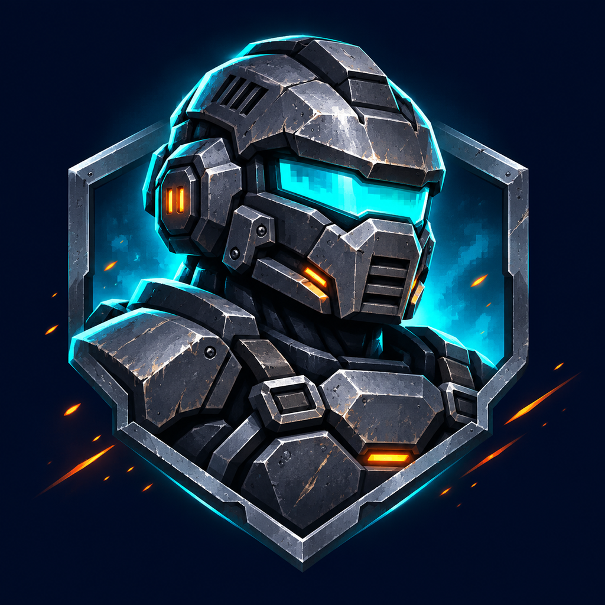
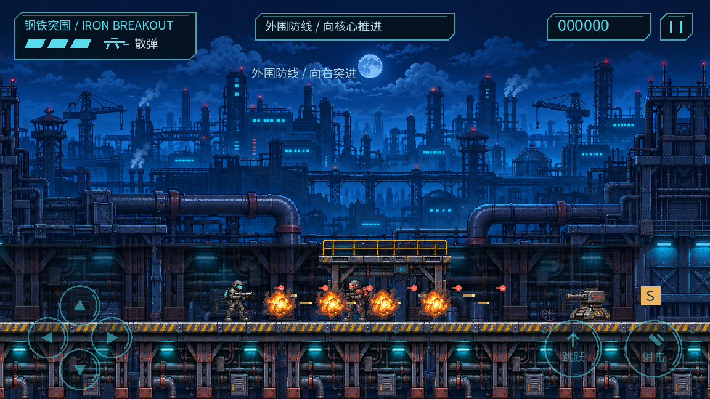
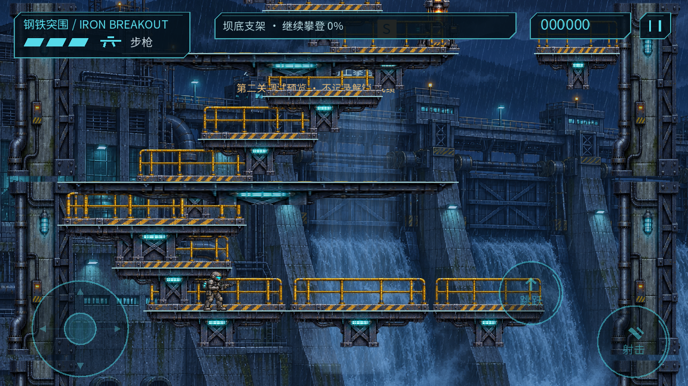
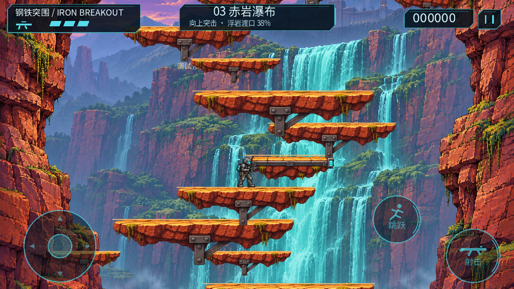

<p align="center">
  
</p>

<h1 align="center">钢铁突围 · Iron Breakout</h1>

<p align="center">穿越工业防线，攀上暴雨水坝，突入赤岩要塞。</p>
<p align="center">Android 离线单机射击游戏 · Godot 4.7.2 · GDScript · 开发中</p>

受经典街机跑跳射击玩法启发的原创项目，以暗夜工业科幻为视觉方向，结合横向交火、纵向攀登、武器拾取与 Boss 战。游戏无需联网，不包含广告、内购或账户系统。

**当前版本：0.5.2-prototype。** 三个关卡均可在“选择行动”中直接进入。项目仍为可玩阶段原型，持续体验与设备适配正在完善。

## 游戏画面

以下为游戏引擎实际渲染的桌面开发场景采样，包含调试预览与特效测试场景；不是概念效果图，也不代表手机性能或最终画面验收。部分截图来自早期阶段，HUD 以当前运行版本为准。

**钢铁突围 · 工业防线与交火**



**暴雨水坝 · 左右折返、纵向攀登**



**赤岩瀑布 · 峡谷平台与移动渡台**



## 核心内容

- **三关、三个 Boss**：工业前哨的横向突破、暴雨水坝的纵向折返，以及赤岩瀑布的移动平台、落石与热流挑战。
- **五种武器**：普通步枪、M 机枪、S 散弹、L 脉冲激光、F 螺旋火球；拾取胶囊即可换装。
- **R 强化**：强化射速与适用弹体的速度，重复拾取不叠加；激光保留 R 状态，但不享受加速。
- **跑跳与平台下穿**：支持下蹲、正上及斜上瞄准，普通架空平台可通过“正下＋跳跃”下穿。
- **触屏优先**：虚拟摇杆与独立动作键，提供自动射击、按钮大小、透明度、音量和低特效设置。
- **检查点与分关成绩**：支持死亡重试和各关最佳得分；检查点仅在当前游戏进程内有效，不支持退出后续关。
- **原创视听资产**：自制场景、角色、特效与合成音频，保留图像生成记录、制作脚本和资产清单。

| 关卡 | 主题与玩法 | Boss |
| --- | --- | --- |
| 01 钢铁突围 | 夜间工业厂区、分段遭遇、清敌突破 | 工业炮台 |
| 02 暴雨水坝 | 一屏宽纵向攀登、左右折返、可选供能节点 | 潮汐守卫 |
| 03 赤岩瀑布 | 峡谷登高、横移平台、局部分路、环境危险 | 崖心堡垒 |

## 下载与安装

**[下载 Android APK（蒲公英托管）](https://www.pgyer.com/gangtietuwei)**

使用 Android 手机打开上方链接，按托管页面提示下载安装。源码仓库不包含本机构建目录与签名密钥。

当前本地构建为 **0.5.2-prototype / versionCode 10**，支持 **Android 7.0（API 24）及以上的 arm64-v8a 设备**。系统版本满足要求不代表已完成该设备的运行验收。

安装时使用 Android 系统的 APK 安装流程，按需允许安装来源。现有内部 Release 使用测试证书签名；正式发布签名尚未配置。覆盖安装需要包名与签名一致，勿为解决签名不一致而直接清除已有存档。

构建与签名验证范围见 [Release 记录](docs/RELEASE_BUILD.md)。

## 操作

| 动作 | 触屏 | 键盘 |
| --- | --- | --- |
| 左右移动 | 左侧摇杆左右推 | A / D 或 ← / → |
| 向上 / 斜上瞄准 | 摇杆上推 / 斜上推 | W / ↑，可同时按移动键 |
| 下蹲 | 摇杆向下推 | S / ↓ |
| 跳跃 | 跳跃按钮 | 空格 |
| 向下穿过平台 | 正下推住，再点跳跃 | S / ↓ ＋空格 |
| 射击 | 按住射击按钮，或启用自动射击 | 按住 J |
| 暂停 / 返回 | 右上角暂停；Android 返回键 | Esc |

下穿只适用于普通架空平台；实体地面和 Boss 底板不可下穿。斜下＋跳跃仍为普通跳跃，连续下穿需要松开跳跃后再次触发。

武器由拾取切换，没有独立切枪键。受伤不掉枪，死亡、重试与进入新关会恢复普通步枪并清除 R 强化。保留键盘与手柄输入路径，蓝牙手柄硬件尚未完成实测。

## 从源码运行

使用 **Godot 4.7.2 标准版（GDScript）** 打开根目录的 `project.godot`，等待资源导入后按 **F5**。项目采用 **Compatibility** 渲染器，逻辑画布为 960 × 540。

仓库中的自动化工具主要面向 macOS，依赖 Python 3。引擎与 Android 导出模板不随源码提供：

```sh
# 下载锁定版本的 Godot 与 Android 模板，需要网络及足够磁盘空间
python3 tools/manage.py bootstrap

# 启动游戏
python3 tools/manage.py run

# 运行逻辑回归
python3 tools/manage.py test
```

也可将 `GODOT_BIN` 指向已有的 Godot 4.7.2 可执行文件。其他桌面系统可通过 Godot 编辑器运行；自动化构建脚本的跨平台适配尚未验证。

## 构建 Android APK

在 macOS 上准备 **JDK 17**、Android SDK（Platform Tools、对应平台与 Build Tools）及锁定的导出模板。可用 `ANDROID_SDK_ROOT` 和 `HDL_JAVA_PATH` 指定本机 SDK/JDK 目录。

```sh
# 创建本地调试密钥并构建 Debug APK
python3 tools/manage.py build

# 安装 Debug 包并启动，设备需开启并授权 USB 调试
python3 tools/manage.py install --serial YOUR_DEVICE_SERIAL

# 使用已有内部测试密钥构建非调试 Release APK
python3 tools/build_release.py
```

输出分别为 `builds/iron-breakout-debug.apk` 与 `builds/iron-breakout-release.apk`。Release 工具依赖已存在的本地测试密钥，首次使用应先完成 Debug 构建。它不会创建正式发布证书，也不会上传或自动安装 Release 包。

`work/` 存放引擎、模板、密钥及临时日志；`builds/` 存放构建产物，均已在 `.gitignore` 中排除。请勿将签名密钥提交到仓库。

## 项目结构

```text
assets/          游戏使用的图形、字体、音频与依赖许可
resources/       关卡、武器等配置资源
scenes/          Godot 场景
scripts/         角色、战斗、关卡流程、渲染与 UI
source_assets/   原创资产源文件、图像生成提示词与来源记录
tests/           GDScript 逻辑回归
tools/           构建、素材制作与验证工具
docs/            设计方案、执行记录及验证证据
project.godot    Godot 工程入口
```

## 开发状态

最近一次玩法修复的逻辑回归为 **191/191 通过**，并检查了实际桌面选关截图。历史 Android 验证仅覆盖单台设备；最新 0.5.2 Release 尚未做本轮真机安装验收。

仍需完成的工作包括正常游玩下的关卡节奏与武器平衡、完整动作与音频体验、持续三指操作、20 分钟真人连续游玩、多设备与手柄验证。逻辑模拟和自动无敌回放不替代上述验收。

欢迎通过 GitHub Issues 反馈问题，尽量附上版本、设备型号、Android 版本、复现步骤和截图。

## 开发文档

- [完整打磨规划](docs/POLISH_MASTER_PLAN.md) · [开发计划与历史进度](docs/DEVELOPMENT_PLAN.md)
- [第二关纵向设计](docs/LEVEL_02_VERTICAL_REDESIGN.md) · [第三关设计](docs/LEVEL_03_DESIGN.md) · [武器设计](docs/WEAPON_EXPANSION_DESIGN.md)
- [自由选关修复与验证](docs/evidence/mission-selection/REPORT.md) · [五武器验证](docs/evidence/weapons/REPORT.md)
- [QA 状态](docs/QA_STATUS.md) · [已知限制（含历史阶段记录）](docs/KNOWN_ISSUES.md)
- [资产清单](docs/ASSET_MANIFEST.csv) · [第三方声明](docs/THIRD_PARTY_NOTICES.md)
- [Agent 执行计划](docs/AGENT_DEVELOPMENT_PLAN.md) · [执行台账](docs/AGENT_PROGRESS.md)
- [旧 README 开发记录归档](docs/README_HISTORY.md)

设计与验证文档保留阶段历史；已被后续需求覆盖的规则，以当前实现和最新专项记录为准。

## 资产与许可

项目图形由本项目制作，其中部分位图与 App 图标采用 **AI 辅助原创制作**；原始图、提示词和制作记录保留在 `source_assets/`。音乐和音效由项目内合成脚本制作，不使用无来源的商业游戏素材。

第三方依赖按各自许可使用：Godot 引擎声明见 [Godot.txt](assets/licenses/Godot.txt)，Noto Sans SC 字体采用 [SIL Open Font License 1.1](assets/fonts/OFL.txt)，来源见 [字体记录](source_assets/font-source.txt)。

**当前仓库尚未选定项目整体的开源许可证。** 代码与原创资产的使用、修改及再分发授权范围尚未确定；第三方组件继续遵循其各自许可。仓库公开不等于已经授予项目整体的开源授权。
