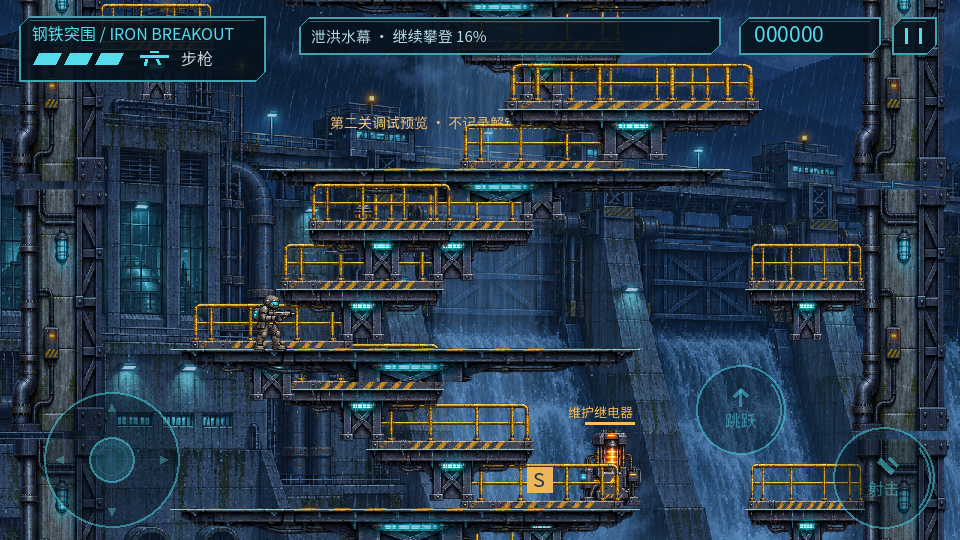
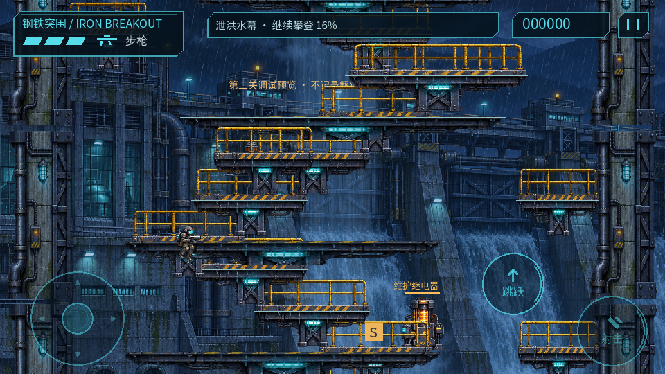
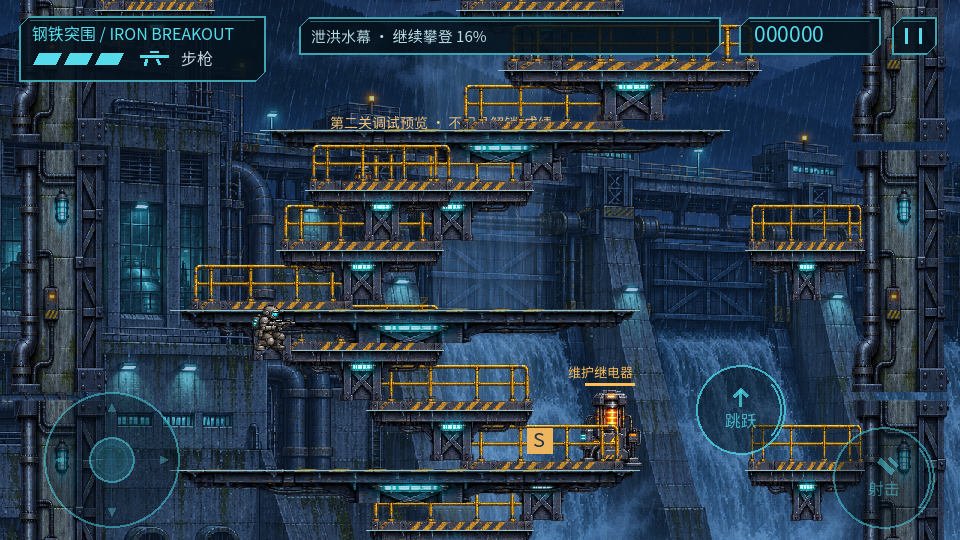

# 0.3.2 平台下穿 / 2026-11-04

用户批准增加“下＋跳”下穿。本批已接入两关并构建手机调试版，保留阶段原型标记。

## 行为

站稳在普通架空平台，明确正下＋新按一次跳跃，下穿当前支撑高度。忽略该高度所有重叠平台，脚底越过4像素后解除过滤；下一层碰撞始终开启，无长固定穿透时间。消耗本次跳跃缓冲与离台宽限，初始下落速度90；长按不会连续下穿，需松开再按跳跃。下降过程中可移动/射击，沿用现有下落动画。

实体floor_rects与显式solid_platforms始终优先阻止下穿，含起点和Boss底板；普通架空平台默认允许，可由LevelSpec.allow_platform_drop统一关闭。没有关闭所有碰撞或把平台永久移除。

触屏需纵向≥65%行程、横向≤25%且没有左右/向上动作，避免斜下误触。键盘S/下箭头＋空格；手柄正下推＋A。斜下＋跳仍是普通跳跃。暂停冻结当前下穿状态，恢复后继续；重试/切关/坠落恢复清除残留；最高进度与检查点不因下降倒退，旧遭遇和拾取不刷新。

## 验证分类

**逻辑回归**：python3 tools/manage.py test，125/125，正常退出。[日志](tests.log)。新增14项覆盖重叠支撑层、同时射击/缓冲清除、下层落地、长按不连穿、再次按键、暂停、重试、斜下、浅/深触屏下推、顶部实体覆盖、第一关实体/架空平台、切关清理。20分钟逻辑soak仍不是手机长测。

**桌面实际渲染**：tools/check_drop.gd在真实第二关第9个平台布置角色，以固定步输入连续采样21帧；已实际查看00/04/20帧，分别为原平台、下穿中和下层落地。[状态序列](desktop-states.json)。这是隔离物理/渲染夹具，非真人、手机性能或全关回放。

**单设备**：JER-AN20 / Android12，0.3.2-prototype code6，no-streaming覆盖安装Success，保留数据。尝试ADB键盘上跳/下跳组合，但第一次上跳没有被稳定采到，后一次组合仅观察到上跳，因此[此尝试](adb-input-attempt.json)不算手机下穿成功证据。桌面逻辑和合成触屏阈值测试已通过；手机真实多指下推＋跳跃仍待用户试玩，不能把ADB键盘结果冒作触控验证。

APK SHA256 f48303517ae5ba126f0ceab90e278c452770207360fe7a46e855c9a51eb540ca，运行源身份见[build-identity.json](build-identity.json)。原始日志/CSV/帧位于work/drop-through。

## 交付与剩余项

操作文档docs/CONTROLS.md已更新；阶段包builds/drop-through-stage保存源码、APK、构建身份及manifest。现有真人节奏、听检、20分钟、多设备及手柄欠验收继续保留。本批没有声称已通过这些条件，也没有为小功能重复做长测。

最终设备检查：实际安装版本0.3.2/code6；自动诊断与一次性预览文件均已撤除/消费，当前进程未发现脚本/解析/ERROR日志。手机停在第二关起点暂停页，点击继续即可试玩；调试预览不记录正式解锁/成绩。最终截图已实际查看，见[检查](final-check.json)和[截图](final-device.png)。
