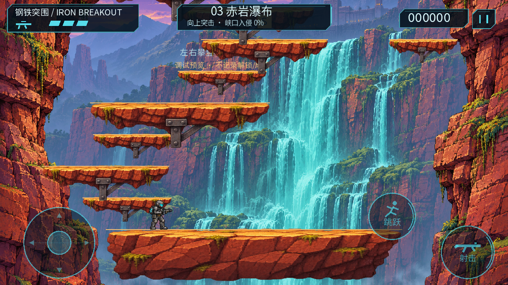
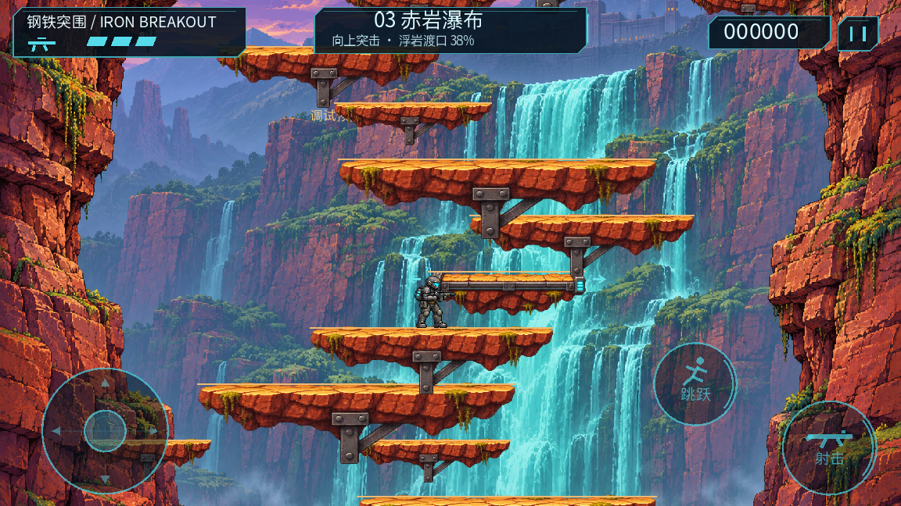
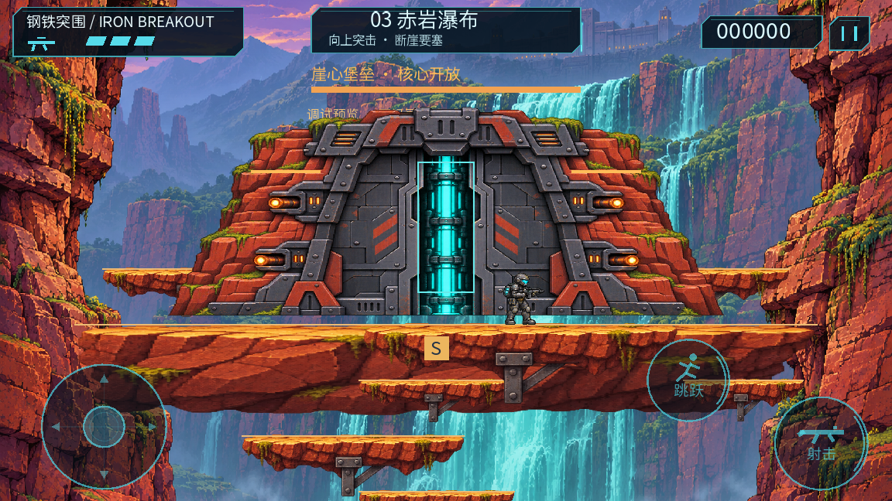
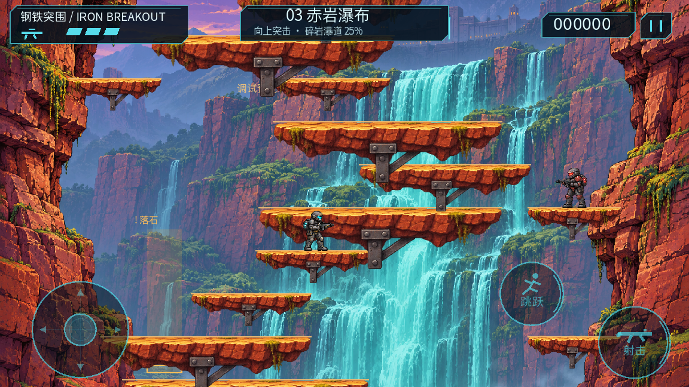
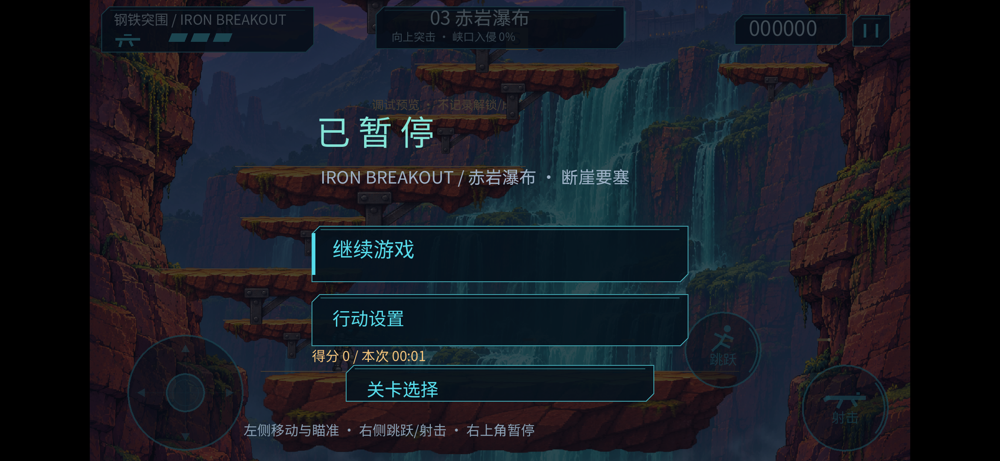

# 0.4.0 赤岩瀑布 · 第三关阶段交付

2026-11-05 / Asia/Shanghai。用户已确认规划/UI并明确要求开发；执行计划LEVEL_03_AGENT_DEVELOPMENT_PLAN.md，台账LEVEL_03_PROGRESS.md。本报告区分实际实现、逻辑、桌面渲染、单设备与未测试，不声称成品终验完成。

## 已接入内容

- 第三关独立LevelSpec/生成源：960宽、固定x镜头、净登高2640、44次主路上升，六区、11组遭遇、两条短分路、四个检查点含起点。前3跳无机关。普通敌人总上限6，教学区单敌人；节点不封锁推进。
- 两座解析式水平横移台：站稳随台、起跳/下穿脱离、按真实位置接住角色、相位重置；不是装饰性漂浮台。固定候台/承接台保留，动态台不能记录为安全恢复点。第一座位于主路，第二座有固定台分路。
- 两列落石有可见预警/固定落点/单次1HP保护；只在完整可观察范围启动，离开屏幕清待发落石。两处热流复用预警/有效/冷却；Boss阶段关闭外围危险。暂停冻结，死亡/重试/切关重置动态状态。
- 独立崖心堡垒Boss：核心周期开放、左右炮口组可选；无需拆炮口就能通关。美术每侧有两个炮管，共用该侧HP。常规扇弹和局部落石由同一周期协调，不是三个随机计时器叠加。完整实体底板与两侧可下穿岩台，弱点可用原有向上/斜上瞄准命中。
- 三卡选关、真实第二关胜利解锁第三关、三关独立最高分、顺序进入/重玩/返回流程。旧成绩不推断通关；调试预览/自动回放不写解锁成绩。检查点按关卡ID/序号、得分/已触发遭遇/拾取/最高高度快照回滚，Boss重试恢复完整战斗。
- 三条原创合成音乐和两条石头提示/撞击音，12声道与64特效槽保留。内置image_gen生成独立背景、透明岩台图集和要塞部件，源图/提示/测量region与元数据见source_assets/art/level03，清单84项哈希已更新。没有下载魂斗罗地图、精灵或音乐。

## 概念图与实际UI

赤褐岩壁、冷青瀑布、远山/薄雾、中央顶部要塞、青色描边HUD和错位圆形跳跃/射击键均按已确认图制作；角色和敌人沿用现有原创图集。HUD重做第三关标题、目标/高度、三生命、枪械、得分和暂停；跳跃为跑动图标，射击为枪械轮廓。

实际安全区、摇杆与按钮命中范围沿用已改善误触的布局，按钮透明度设置继续生效。平台距离依物理能力重排，无法把概念中几百像素的间距当作现有单段跳可达距离；这里交付动态可玩场景，不声称与单张生成图每个像素相同。默认主题、视觉层级和元素落实，最终美术/手感仍需用户试玩评审。

## 逻辑与桌面验证

旧0.3.2可恢复快照位于work/level03/baseline，重新运行125/125。最终 `python3 tools/manage.py test` [155/155](tests.log)，正常退出，无脚本解析错误。新增骑乘/脱离/下穿、暂停/重试、落石伤害/屏外重置、CP快照、核心护盾/炮口奖励、一次结算、正式/调试解锁、三卡命中与30次逻辑三关轮换。测试保护并恢复原桌面设置文件。

[73项地形/相位与第三关通路](route-logical.json)：44主路边、9分路边、20个额外移动台多相位登乘/离台检查，使用真实控制器、固定步物理、无战斗/无无敌；73/73通过。另行完整输入无敌回放成功，35.08模拟秒，两个炮口均保持8HP，证明直打核心路线；不传送替代完整主路，但不证明正常回避公平或真人4～6分钟。

[第一关](factory-route-logical.json)：27/27且通关；[第二关](level02-route-logical.json)：54物理边、完整通路及不破坏可选节点通路均通过。都属无敌逻辑回放，不能冒充真机性能或真人时长。

连续桌面序列通过tools/record_level03.gd导出，实际查看ferry0010/0011、drop0001/0002、boss0047/0048等相邻帧及顶部修正后截图。每4个固定步采一帧（15采样帧/模拟秒），从独立布置场景开始且有无敌闪烁，因此部分帧角色闪隐属预期；不是手机录屏/人工游玩或实时性能视频。

[移动台连续记录](ferry-desktop.mp4) · [下穿连续记录](drop-desktop.mp4) · [核心窗口连续记录](boss-desktop.mp4) · [采样口径](motion-metadata.json)。

## Android单设备证据与版本边界

设备JER-AN20 / Android12 / 2340×1080，TNL0220818008145，Compatibility。使用no-streaming覆盖安装，未卸载/清数据。第三关已实际运行、显示并截图。用户当前设置/解锁不由debug回放写入。

首次候选APK SHA256 `8927da11696d49c99677c75f4ff96d502456b9a80ac3b7bcf0d999168da28f09`：

- [90秒路线](device-route/replay-status.json)完成2次胜利；有效playing采样89.57秒，P95 18.459ms/P99 20.793ms，静态峰值68,678,734字节。开局0.267秒有一次131.576ms慢回调，原始保留；同采样后续无≥100ms。不能写成“没有卡顿”。
- [23次重试](device-retries/retry-summary.json)，3预热后20样本，全新/维护CP各10，节点4/音效12；末尾静态增长分别0/716字节，两组非严格单调；此批有效playing无≥100ms。其他CP目前为逻辑验证，不能称全部人工真机通过。
- [33次三关切换](device-switches/retry-summary.json)，3预热后每关10样本，节点4/音效12。相同关卡分组静态增长约13.4KB/1.3KB/1.5KB，均在增量预算内；第二/三关分组存在微量单调增长，故不宣称无泄漏或完整稳定性门槛通过，仍待长测/PSS/GPU分析。

收尾修正两项：HUD按用户设置比例调整透明度；首座移动台前的守卫下移一层，并新增首次候台不受前段火力干扰的回归。最终APK SHA256 `f4b304f06dcd9e81203baf0a6167e134c862db7175b8c1c0e666fc0826c031eb`，version0.4.0-prototype/code7。两包[运行源差异](candidate-final-diff.json)为scripts/ui/hud_renderer.gd与resources/levels/redrock.tres；候选重试/切换数据保持其原始build-identity，不冒写成最终包重复采样。

**最终包单设备复查**：[90秒输入路线](device-release-route/replay-status.json)完成2次胜利、0死亡、未被人工打断；有效playing采样89.51秒，P95 18.974ms / P99 22.044ms，≥100ms为0，静态峰值68,677,636字节。此结果不抹去候选首次131.576ms冷启事件，冷启多次复验仍保留。

**最终手机状态**：[检查记录](final-device-check.json)核对0.4.0-prototype/code7，当前PID无SCRIPT ERROR/Parse Error/ERROR日志。qa-replay、telemetry及一次性preview文件已撤除/消费；手机留在第三关起点暂停页，点继续即可试玩。最终预览前后设置一致，此比较只覆盖最终预览阶段，未声称对比了本轮最初安装前的配置。Debug预览不写正式解锁/成绩。截图已实际查看。

回调间隔不是独立GPU/呈现耗时；Godot静态内存不是Android总PSS或显存。采样为ADB启用的无敌输入回放，不代表触屏硬件/人类躲避/热感/听感。单设备也不等于多设备。

## 仍未通过的验收

这是可试玩第三关阶段版：真人移动台登乘/下穿多指手感、全部危险组合正常回避、至少3次正常成功计时、45～75秒Boss与4～6分钟整关软目标均待验证。无敌最优通路较短，不以加血、等待、重复台阶凑时长；后续依据真人反馈调整有意义的选择与遭遇。

耳机/外放音乐混音听检、20分钟真人连续运行、首轮131ms开局慢帧冷启动复验、三关分组微量单调增长、额外设备/手柄和正式签名发布条件保留未完成。原一期/第二关欠验收不因第三关接入而结案。

工作原始CSV/日志/全部连续帧保存在work/level03；精简证据与可重建源随阶段包交付，work、引擎/SDK与签名密钥不分发。构建工具自动创建work/.gdignore，避免原始诊断和截图被引擎当生产资源导入。

## 交付

builds/level03-stage包含最终APK、build-identity、可编辑源码快照与manifest；源快照含原创生产资产/生成脚本/提示词/文档证据，排除work/密钥/引擎/SDK。重建：python3 tools/manage.py test，然后python3 tools/manage.py build。下一优先是用户正常试玩、首次移动台与下穿手感、正常Boss回避和成功计时，再依据数据调整节奏。
