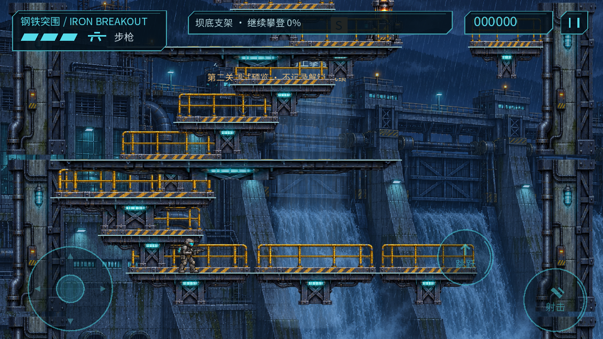
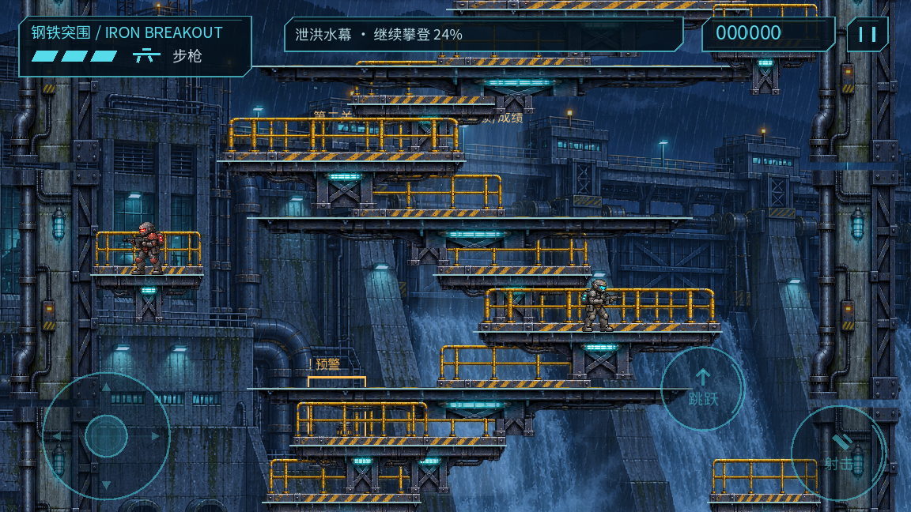
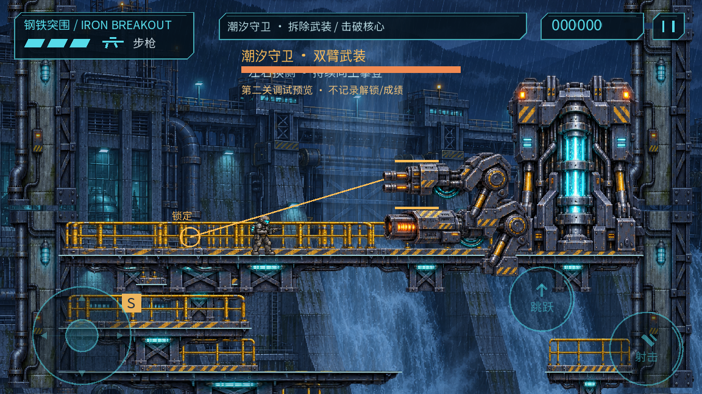
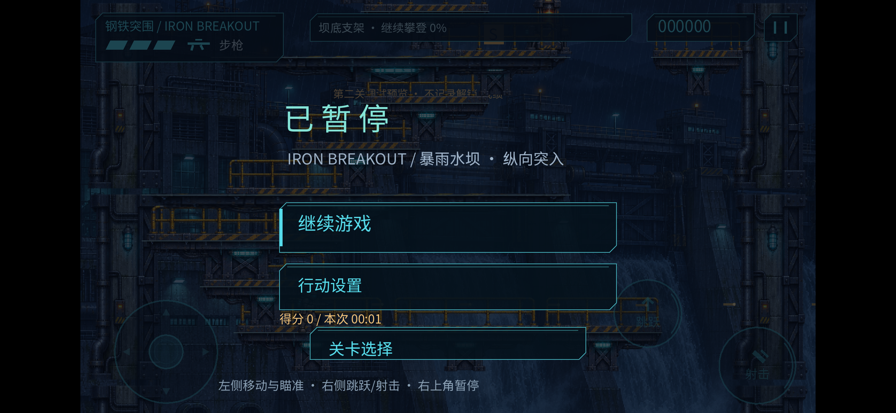

# 0.3.1 纵向第二关阶段交付 / 2026-11-04

用户明确批准纵向方案并要求实施。本报告只记录本批真实验证；不是产品终验。

## 行为与结构

第二关由13,800宽的横向主线重编为960宽、一屏内左右攀登。主路54次登高、15次换向，连续同向最多4跳，平台中心水平差最大90、单次上升40～60、净高3120；六区按高度切换目标文案和音乐。主路54/54转换向上。脚本保留确定性坐标源：tools/generate_level02.py，生成resources/levels/spillway.tres。

镜头x固定0，站稳后平滑上移，跳跃死区避免跟随每次起跳晃动；回落可下移，不能仅因掉出屏底判死。每三次登高有可见承接台，转向和检查点台加宽。既有跳跃、缓冲和触屏布局保留。

11组二维触发遭遇，上方/侧面敌人可见后预警开火，活动上限6；越层清理，步兵限小范围巡逻。继电器和两个供能节点改为可选战术收益，关闭电区但不锁Boss或向上主线。普通模式回避公平性仍需真人检查。

四个检查点含起点：维护、供能和峰顶用稳定ID/序号提交，不依赖x递增。快照恢复高度进度、目标、遭遇、拾取与分数；回落不倒退已抵达的进度。顶部同屏直接进入原双臂Boss，激活要求抵达指定高度并落地，普通敌人和外围机关在Boss阶段停止。第一关独立横向流程保留。

原水坝透明图集、背景、合成音乐音效重组复用；未添加外部商业游戏素材。来源/许可/哈希见docs/ASSET_MANIFEST.csv，原创源保留在source_assets及生成脚本。

## 桌面与逻辑证据

- 旧0.3.0基线源码/APK/manifest在work/vertical/baseline，重新运行105/105。
- 本批 `python3 tools/manage.py test`：[111/111](tests.log)，正常退出。包含高处向左检查点、稳定ID恢复、镜头固定x/死区/回落、进度不倒退、Boss高度触发；既有两关/存档/机关/输入等保护继续通过。
- [54步与完整通路](route-logical.json)：孤立每跳使用真实固定步物理控制、无战斗/无无敌，54/54可达；另有两条完整无敌输入通路均成功，其中一条攀登不射击、保留全部可选节点到顶后击败Boss。回放不传送，43.57模拟秒**不是**真人通关时长、正常战斗可解或Android性能。
- [第一关](factory-route-logical.json)：27/27遭遇并成功，152.48模拟秒；同样是无敌逻辑检查。
- 实际查看起步、中层、顶部截图；连续相邻攀登帧0080/0081、Boss帧0060/0061已查看。连续文件为桌面实际渲染、每四个固定步采一帧，15采样帧/模拟秒；单独布置场景且无敌，非手机录屏、真人操作或实时性能视频。

[攀登连续桌面记录](climb-desktop.mp4) · [Boss连续桌面记录](boss-desktop.mp4) · [采样标注](motion-metadata.json)

## Android单设备

目标为JER-AN20 / Android12 / 2340×1080，串号TNL0220818008145。使用no-streaming覆盖安装成功，未清除应用数据。当前APK0.3.1-prototype（versionCode5），SHA256 `48ba28db754e9f572465ef7ffc733d062e47e77ecf9ff3848f75c969f2d6820a`。构建身份与运行源哈希见build-identity.json。

[自动路线记录](device-route/replay-status.json)：90.02活动模拟秒结束，完整成功2次，未死亡，未检测到人工打断；有效帧回调采样89.41秒，P95 18.351ms、P99 20.399ms、≥100ms为0、Godot静态内存峰值65,514,234字节。全部标记automated_debug_replay。回调间隔不是独立GPU/显示耗时，静态内存不是Android总内存，不据此声称60FPS锁定或无泄漏。

[死亡重试](device-retries/retry-summary.json)：23次完成，3次预热后20样本（全新/维护检查点各10）；节点数固定4、音效节点固定12。全新组末尾静态内存增长0，维护检查点组716字节，没有严格单调增长，均处于静态增长预算。该自动工具只覆盖维护检查点重试，其他高处检查点目前是逻辑回归，不能冒称全部真机人工验证。

[两关切换](device-switches/retry-summary.json)：23次完成，3次预热后20样本，两关各10。节点固定4、音效节点固定12；静态内存末尾增长分别896和648字节，均远低于预算。第二关这一小组存在微量单调增长，尚不能排除长期问题，保留长测与Android总内存验收。

[最终手机检查](final-device-check.json)：安装版本核对为0.3.1-prototype/code5；已撤除qa-replay和telemetry，一次性预览文件已消费。手机留在新版第二关起点暂停页，点“继续游戏”即可试玩；调试预览不记录正式成绩/解锁。最终启动前后settings.cfg一致，当前PID日志未发现SCRIPT ERROR/Parse Error/ERROR。截图已实际查看。此设置比较仅覆盖最终预览前后，不声称对比了本轮最初安装前的设置。

原始CSV/ADB日志/全部相邻帧在work/vertical，精简可复核摘要随本报告保存。

## 尚未通过的验收

这是可试玩阶段版。用户需要确认新版“左右向上”的体验；新版真人三指输入、正常战斗/全部检查点回避与至少3次成功通关计时尚未做，4～6分钟软目标未证实。自动最优无敌路线较短，后续依据真人数据增加有判断价值的变化或删减重复，不用强制等待、堆血和无意义加高凑时间。

耳机/外放听检、真人20分钟持续运行、第二/第三设备与手柄均未完成；既有一期欠验收继续有效。20分钟逻辑soak和本批短自动采样不能代替它们。现有射击/攀登不包含新攀墙动作或抓边系统，这符合已批准的固定平台方案。

## 交接

下一优先为用户试玩反馈、正常成功计时、跳台与遭遇节奏调整；同一范围内常规修复可自主继续。历史0.3.0证据保留，不能混作0.3.1已验证项。阶段交付包含builds/vertical-stage中的APK、构建身份、可编辑源码快照和manifest；work与签名密钥不分发。
