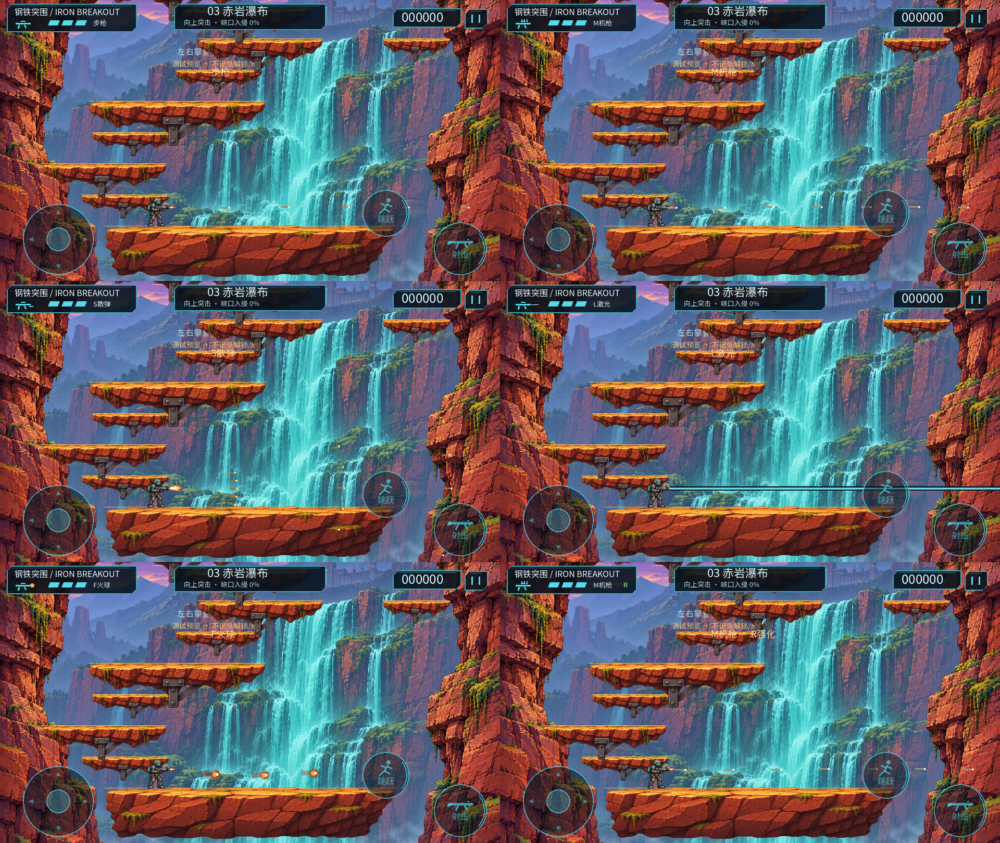
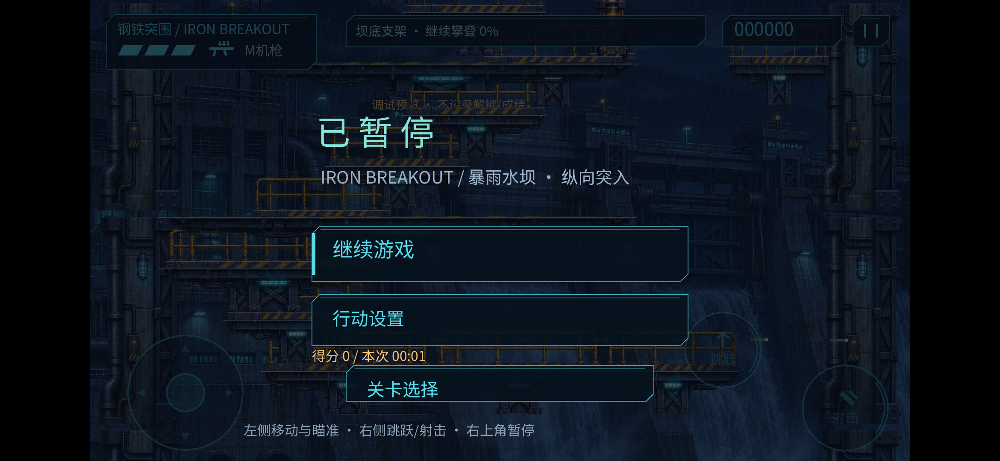

# 0.5.0 五武器＋R阶段交付 / 2026-11-05

用户确认设计方案并直接要求完成；已补齐WEAPON_AGENT_DEVELOPMENT_PLAN.md后实施。本报告只记录实际范围，不表示所有真人/硬件终验通过。

## 已实现

普通枪保留；M机枪高速直线连射，S改五方向扇射，L为独立短脉冲穿透，F为瞄准坐标内的小圆周火球。全部可按住射击，沿用原有平射/正上/斜上与共享枪口、跳跃/下蹲/下穿及自动射击设置，无新切枪按钮。

R一层，普通/M/S/F间隔×0.85、弹速×1.15；L不受加速但保留低亮R标记。重复R不叠加、不加分。新枪不改变旧弹属性，受伤保留装备；死亡当帧、CP重试和新关回到普通枪并清R/旧弹/光束。修正致死坠落当帧自动射击/音乐继续的问题，遍历弹丸时致死清理安全退出。

武器ID为唯一状态，旧weapon布尔只是派生的历史诊断/测试兼容入口。Resource配置间隔/弹速/伤害/寿命/弹型；统一路径扫掠先命中最近目标。敌人使用稳定ID；目标/敌人/Boss统一接受伤害，阶段护甲仍由Boss脚本决定。

五发S共享一轮批次：Boss总有效伤害最多2且只命中一个有效部位；不越过第二关护甲或第三关关闭核心。L每束最多3个普通敌人、各一次，遇Boss或节点停止；残光不再判伤。F分段扫掠圆周路径，尾焰没有伤害。击杀、节点与部位奖励一次，三Boss血量未为新枪全体堆高。

三关配置带稳定ID的M/S/L/F/R拾取；每关一个R。第一关M早段/S中段/L后段，第二关S/F/R/L，第三关M/F/R/L。每次Boss尝试一个可选S补给，固定安全位置、可在入场保护期接近，不加分不回血；尝试补给不写CP消费，其他拾取按快照回滚。第一关也补齐消费快照，整关重开清旧快照。普通枪与不拿R仍能通关。

三关HUD显示武器文字/轮廓和R状态，胶囊字母与颜色可区分。M/S/L/F弹型均实际渲染，第三关原赤岩瀑布主题和前两关主题保留，触控命中布局不变。特效由原创GDScript绘制并复用原自制枪口/命中图集；M/L/F三音效由tools/generate_audio.py原创合成。清单93项哈希更新，无外部游戏素材。

## 逻辑回归与平衡证据

旧0.4.0源/APK/身份在work/weapons/baseline，基线155/155重跑。最终 `python3 tools/manage.py test` [186/186](tests.log)，正常退出；新增31项覆盖扫掠最近目标、L三目标/节点终止/残光去重、S批次限伤/部位、F方向/枪口/属性、R与激光、拾取/CP/死亡、容量及27列武器遥测。20分钟逻辑soak不算手机长测。

[五枪×三Boss×R开关矩阵](boss-matrix.json)：30/30成功，无容量等待。独立布置Boss起点、固定步输入、无敌且移除拾取以锁定武器。下面是**无R的模拟秒数**，不是人工成功时长或难度验收：

| Boss | 普通 | M | S | L | F |
| --- | --- | --- | --- | --- | --- |
| 核心防御机 | 9.37 | 6.58 | 9.08 | 8.77 | 10.30 |
| 潮汐守卫 | 16.77 | 11.78 | 14.25 | 13.77 | 13.28 |
| 崖心堡垒 | 15.85 | 11.80 | 15.85 | 12.52 | 13.05 |

R开启的15项也成功，L时间不因R改变；完整逐项输出、发射数、有效伤害与剩余HP在JSON中。M提高持续输出；S不再因大部位五弹叠加而支配Boss；L主打穿线，F主打单发与局部覆盖。本批未修改三个Boss血量/核心规则，但正常躲避下的输出和时长仍需真人对照，不能用这张表称平衡完成。

[第一关完整通路](factory-route.json)、[第二关物理与两条完整通路](level02-route.json)、[第三关73物理/相位与完整通路](level03-route.json)均通过，使用实际固定步控制、正常拾取编排；整关回放有无敌，不能代替真人或手机性能。孤立物理边不含战斗，与整关无敌来源分开。

另有五武器×R开关共10组、各20模拟秒的无战斗对象检查：友弹峰值最高30、可见光束峰值1，容量等待0，低于80/4预算。S每轮完整五发，无随机吞弹；激光的命中列表只活在发射调用，S共享批次随最后一弹释放，无全局无限命中表。此检查不等于20分钟性能通过。

## 实际画面

已实际查看五枪/机枪R对照图、L000/001与F010/011相邻帧，以及前两关L＋R（低亮未加速）的HUD和拾取图标。所有图片为真实Godot桌面渲染的隔离夹具，非概念图、手机截图或人工战斗。前两关图中为验证图标临时布置了五个胶囊，正常关卡投放按Resource。

[前两关HUD一](hud-factory.png) · [HUD二](hud-spillway.png) · [M连续帧](machine-desktop.mp4) · [S连续帧](spread-desktop.mp4) · [L连续帧](laser-desktop.mp4) · [F连续帧](fireball-desktop.mp4) · [M＋R](machine-R-desktop.mp4)。每帧2个固定步，30采样帧/模拟秒，原始35帧/组在work/weapons/motion；不是手机视频或实时性能证据。

## Android单设备

JER-AN20 / Android12 / 2340×1080 / Compatibility，串号TNL0220818008145。ADB一度离线，恢复未成功后用户重连，no-streaming覆盖安装Success；未卸载/清数据。最终0.5.0-prototype/code8，APK SHA256 `5c1b1e5ff94805d1d99e6fb042b8030a793a08df612ac2674488b42a937e61c3`。各批采样保留同一构建身份；源/资产完整性见[integrity.json](integrity.json)。

| 检查 | 实际结果 | 范围 |
| --- | --- | --- |
| 正常投放第三关自动路线 | 90.02活动秒，完整胜利2次；有效回调采样89.44秒，P95 19.769ms/P99 22.621ms，≥100ms为0，静态峰值70,102,439字节 | 无敌输入回放，未锁枪，真实拾取；看到普通/M/F/L及R，未声称此路线覆盖S |
| 首次压力重试 | 7次后因真人触控自动停止；预热后仅4样本 | **未达到20样本**，保留原始记录，不拼接成成功 |
| 用户确认空闲后完整重试 | 23次，3预热后20样本，全新/维护CP各10；五枪轮换＋R全部观测到，节点4/声道12；静态增量组间末尾均为负且非单调 | 移除拾取的锁枪压力夹具，不是正常拾取/死亡装备恢复的人工证明 |
| 三关轮换 | 33次，3预热后每关10样本；五枪/R覆盖，节点4/声道12；分组增长约24KB/1.36MB/16KB，均低于静态预算且非单调 | 仍不证明Android总PSS/GPU无泄漏 |

完整重试采样68.59秒，P95 19.994/P99 22.781ms、≥100ms为0；三关切换采样98.95秒，P95 19.189/P99 21.904ms，**有一次175.824ms慢回调**，发生在6.036秒首次切入第二关、预热阶段。该事件保留在[slow-frames.json](slow-frames.json)，不因预热剔除就声称“没有卡顿”，首载/切关性能仍需打磨。

两个压力批次总弹丸峰值32（含敌弹）、可见光束峰值1；实际武器ID/R覆盖见[device-coverage.json](device-coverage.json)。源数据：[路线](device-route/replay-status.json)、[中止批次](device-retries/retry-summary.json)、[完整重试](device-retries-complete/retry-summary.json)、[三关切换](device-switches/retry-summary.json)。完整批次保留replay-config，循环模式每8秒轮换一枪，普通操作者不可触发此配置。

帧值是应用回调间隔，不是独立GPU/呈现帧时；静态内存不是Android PSS/显存。自动无敌采样不验证触屏硬件、正常回避、声音听感或温升手感，多批短采样不能拼成真人20分钟。

## 最终手机与交付

[最终核对](final-device-check.json)：0.5.0/code8，当前进程无SCRIPT ERROR/Parse Error/ERROR；qa-replay/telemetry及一次性预览文件均撤除/消费。最终预览前后设置一致，此比较仅覆盖最后启动前后，不声称比对了整轮最初安装前设置。

手机留在**第二关起点M机枪调试预览暂停页**，点继续即可试玩；向上推进可依次遇到S、F、R、L，Boss前另有可选S。预览不记录正式成绩/解锁；返回选关后正式开局仍是普通枪，按真实解锁进入。没有隐藏切枪按钮。

builds/weapons-stage提供APK、构建身份、可编辑源码/资源/原创声音生成源/文档证据与manifest；排除work、引擎/SDK、缓存和签名密钥。临时诊断/原始CSV/全部帧在work/weapons。重建为python3 tools/manage.py test，再python3 tools/manage.py build。

## 尚未通过的最终验收

这是五武器阶段原型：五枪正常躲避与三指移动/跳跃/下穿/射击、多武器拾取误触、正常成功通关计时、Boss窗口与输出的真人平衡、耳机/外放听检、20分钟、多设备与手柄仍待验收。首载切关175.824ms与旧0.4.0冷启/微量增长问题保留跟踪，不以本批短测抹去旧缺项。下一优先是用户试玩武器差别与拾取反馈，再按正常战斗数据调数值，不用堆血/强制等待凑时长。
